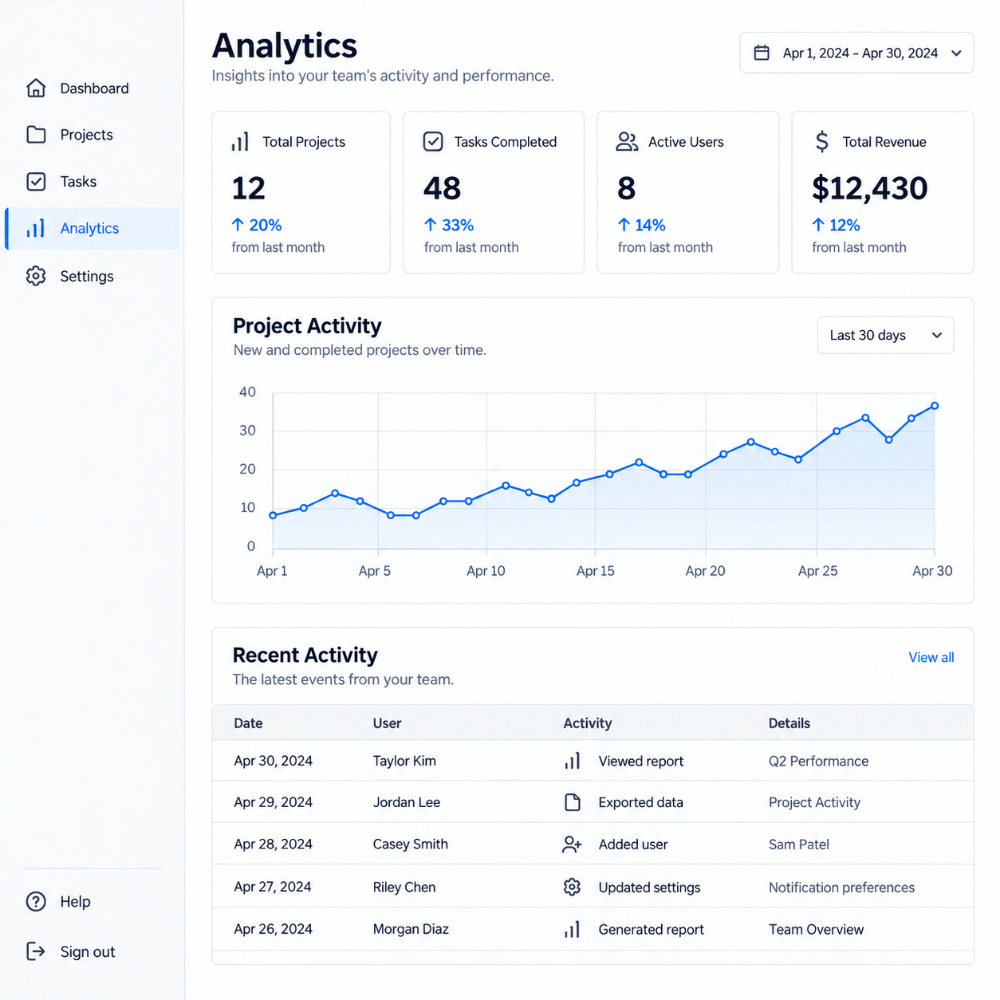
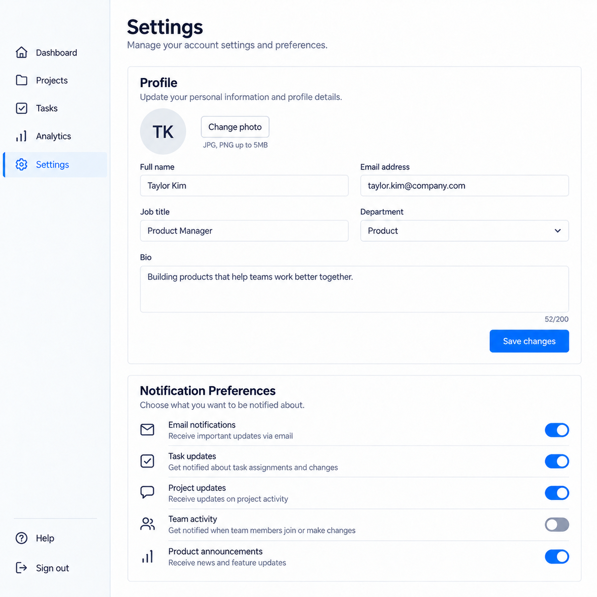

# Idra Photo

**Your AI generates. Idra manages the batch.**

Drag a photo into Codex, type one prompt, say how many images you want. Codex makes every image with its own built-in image tool. Idra hands Codex one job at a time, saves each finished image into a numbered folder, and remembers where the batch stopped so you can pick it up later.

**New: a portable skill + MCP for Codex and Claude Code.** Start with “Use Idra Photo: make 2 skincare photos.” The skill expands the short request into a design brief, explains its assumptions, and checks both the requested content and visual consistency. Claude needs a connected image-generation tool; Idra does not give Claude a built-in photo model. See [Claude setup](docs/claude.md) and [real results with rejected attempts](docs/results/README.md).

## Real generated examples

**Product photos** — “Make 2 square skincare product photos.”

| Front view | Matching angle variation |
|---|---|
|  |  |

**UI concepts** — “Make a matching dashboard and settings screen, square.”

| Dashboard | Matching settings screen |
|---|---|
|  |  |

These are real generated examples reviewed through the queue by a manual Codex host. They demonstrate the short-brief and correction workflow; they are not an autonomous Claude image benchmark.

- Idra itself needs no image API key or extra image service. Claude's connected generator may have its own setup and costs.
- Everything Idra stores stays on your computer.
- Idra itself never generates images and never makes network requests. Codex still uses its own image service and your own Codex plan.

> Status: v0.2.1 adds a short-prompt skill, Claude Code setup, and image inspection to the strict consistency workflow. Automated tests cover acceptance and recovery; [real product/UI examples](docs/results/README.md) show four accepted images and two rejected attempts. Claude Code connected to the MCP and discovered the skill; model-backed Claude generation remains untested. Evidence: [Compatibility](docs/compatibility.md).

This update is currently on `feat/strict-design-consistency`. To try it before the pull request is merged, clone with `git clone --branch feat/strict-design-consistency https://github.com/bbrainfuckk/idra-photo.git`, then use the setup below. A default-branch clone will receive the update after merge.

## Easiest: ask Codex to install it

Paste this into Codex (the desktop app or CLI). Codex downloads Idra, connects it, and checks it.

```text
Install the Idra Photo MCP server for me.

Source: https://github.com/bbrainfuckk/idra-photo (public, MIT license)

1. Use a permanent folder: %USERPROFILE%\idra-photo on Windows, ~/idra-photo on macOS or Linux. Not a temp folder, because Codex runs Idra from there.
2. Get the code: git clone https://github.com/bbrainfuckk/idra-photo.git into that folder. If git is not installed, download https://github.com/bbrainfuckk/idra-photo/archive/refs/heads/main.zip and unzip it there instead. Do not run npm install. The server is prebuilt in idra-photo.mjs.
3. From inside that folder, register it with Codex:
   Windows: .\idra-photo.cmd install-codex
   macOS/Linux: sh ./idra-photo.sh install-codex
   This adds one entry named idra_photo to my Codex config and creates an "Idra Photo" folder in my home folder. My other settings stay as they are. If you need permission to write outside the workspace, ask me.
4. Check it:
   Windows: .\idra-photo.cmd doctor
   macOS/Linux: sh ./idra-photo.sh doctor
   Every line should say ok or info. If it says Node is missing or too old, tell me to install Node.js 22.13 or newer from nodejs.org.
5. Tell me the result and remind me to fully restart Codex.

After the restart I will use it by dragging in a photo and saying:
"Use Idra Photo: make 10 photos in the exact same style as this image, <my idea>"
```

## Or install it yourself (about a minute)

1. Get the folder: `git clone https://github.com/bbrainfuckk/idra-photo.git`, or download the ZIP and unzip it anywhere.
2. **Windows:** double-click `install.cmd`. **macOS/Linux:** run `sh install.sh` in the folder.
3. Restart Codex.

That is all. No `npm install`: the server ships prebuilt as one file, `idra-photo.mjs`.

The Codex installer also installs `skills/idra-photo` into your configured Codex skill folder. For Claude Code, from this checkout run `node idra-photo.mjs install-claude --project "/absolute/path/to/your/design-folder"`; then open Claude Code in that folder. It installs the portable skill and adds the local MCP while keeping other server entries. [Full Claude instructions](docs/claude.md).

When this update is published on the default branch, Claude Code also supports installing the bundled plugin:

```text
/plugin install idra-photo --marketplace bbrainfuckk/idra-photo
```

What the installer does:

- Creates `Idra Photo` in your home folder. Your images go to `Idra Photo/outputs/`.
- Registers `idra_photo` with Codex. Your other Codex settings are kept, and a backup is made if it has to edit `config.toml` itself.
- Lets Idra read photos you drag in from Downloads, Desktop, Pictures, temp, and Codex's own generated-images folder.

Idra needs Node.js 22.13 or newer. On Windows, if you do not have Node, Idra uses the Node that ships inside Codex. The launcher looks for Node every time Codex starts it, so Codex or Node updates do not break it.

Options: `install.cmd --workspace "D:\Shoots\Idra"` picks another folder. `--dry-run` only shows what would be written.

Remove it any time (your images stay):

```bash
idra-photo.cmd uninstall-codex
```

On macOS/Linux use `sh idra-photo.sh uninstall-codex`. Check that everything is ready with `idra-photo.cmd doctor`.

## Use it

Drag your photo into the Codex chat and write something like:

> Use Idra Photo. Make 20 photos in the exact same style as this image: a woman holding our vitamin C serum in a sunny garden. 4:5.

Codex creates the batch, then loops: get a job, generate the image, report it, get the next one. Images land in:

```
Idra Photo/outputs/<batch-name>/
    001-a-woman-holding-our-vitamin-c-serum.png
    002-a-woman-holding-our-vitamin-c-serum.png
    manifest.json
```

More things you can say:

| You say | What happens |
|---|---|
| "Idra status" / "how far is my batch?" | Counts and where it stopped |
| "Pause the batch" | No new images start. One already generating can still finish. |
| "Resume it" | Makes the remaining jobs available again. Codex continues. |
| "Cancel it" | Stops new work. Saved images stay. |
| "Retry the failed ones" | Re-queues failures that are safe to retry. Safety refusals are never retried or reworded. |
| "Make 10 more" | Adds jobs 21-30 with the same style, references, and rules. |
| "Make 5 different concepts: beach, café, gym, office, night" | Diversified mode: one concept per image. |
| "Use these exact prompts: ..." | Explicit mode: your prompts, unchanged. |

### Keeping things the same

For a matching campaign, image series, or UI concept set, ask:

> Use Idra Photo with strict consistency. Make 6 product images using this reference. Keep the cream-and-charcoal palette, soft left window light, matte texture, and typography fixed. Only change the product angle and props. Review every image and correct drift before accepting it. 4:5.

Idra saves a named design contract and repeats its rules in every prompt. It requires a visual review of every rule against the actual generated file. The first reviewed image becomes an additional style reference. Missing reviews block acceptance; failed reviews reject the file and use the bounded retry budget. Recovery and “make more” retain the same contract. See [Strict consistency](docs/consistency.md), [examples](examples/consistency), and the [consolidated design library](design-library).

Existing batches without a consistency contract retain the original behavior:

Codex passes these as rules on every image. They are prompt requirements, not pixel locks. Check the results yourself.

- **Style**: match the reference's color grading, light, lens look, and mood.
- **Product**: keep the packaging, label, logo, colors, and proportions.
- **Identity**: keep a person recognizable.
- **Text**: render given words exactly.
- **Composition**: keep framing and placement.

Each can be `off`, `high`, or `strict`. A valid image file is not proof the product or face was preserved. Idra records whether a visual review was actually done.

### When something goes wrong

- **Codex closed mid-batch.** Say "resume my Idra batch". If an image was saved to its job folder but never reported, Idra adopts it and does not make it again. If Idra cannot tell whether it was made, it asks you before regenerating.
- **Usage limit or tool unavailable.** The batch pauses. Idra never guesses when limits reset and never switches providers. Resume later.
- **Codex stops after one image.** Some hosts end the turn after each image. Say "continue" to go on; Idra keeps the place.

## Privacy and limits

- Idra only reads your workspace folder and the folders listed with `--allow-import`, which by default are Downloads, Desktop, Pictures, temp, and Codex's generated-images folder. It only accepts PNG, JPEG, and WebP images from them, and copies references into the workspace.
- It never reads Codex login files and never asks for passwords, tokens, or API keys.
- No telemetry. Idra makes no network requests at runtime.
- Idra does not make image generation free or unlimited. Every image uses your Codex plan.

## For developers

```bash
npm install
```

```bash
npm test
```

`npm run bundle` rebuilds `idra-photo.mjs` from `src/`. Commit it with your change; CI fails if it is stale.

## Learn more

- [How it works](docs/architecture.md)
- [Compatibility and evidence](docs/compatibility.md)
- [Testing, including the real smoke test](docs/testing.md)
- [Measured overhead](docs/overhead.md)
- [Build status](BUILD_STATUS.md)

MIT licensed. See [LICENSE](LICENSE). Bundled open-source packages and their licenses are listed in [THIRD_PARTY_NOTICES.md](THIRD_PARTY_NOTICES.md).
