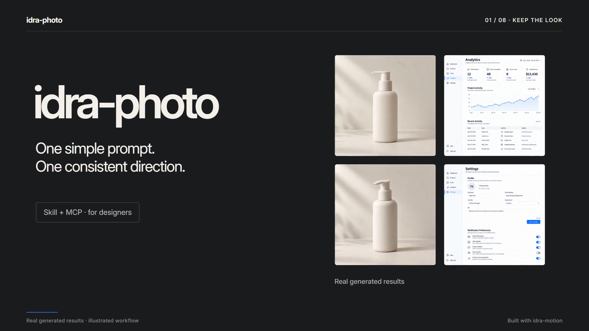

# Idra Photo — Keep the look

[Watch/download MP4](https://github.com/bbrainfuckk/idra-photo/raw/refs/heads/main/docs/trailer/idra-photo-trailer.mp4)

[Download the 60 fps master](https://github.com/bbrainfuckk/idra-photo/raw/refs/heads/main/docs/trailer/idra-photo-master.mp4)

A 36-second, 1920 × 1080 trailer made with [idra-motion](https://github.com/bbrainfuckk/idra-motion). It follows a short request through a fixed design brief, actual rejected/corrected output, matching product photos, and matching UI concepts. Caption-led, with synthesized music and sound effects.

The images come from the [real generation results](../results/README.md). Prompt/brief/review graphics illustrate the workflow; they are not a recording of a separate Idra application. The Claude section states that an image-generation tool must be connected.

## Files

- `idra-photo-trailer.mp4`: 30 fps web cut, under 10 MB, with audio.
- `idra-photo-master.mp4`: 60 fps master with two temporal samples for motion blur, with audio.
- `poster.jpg`: full-size poster from 2.1 seconds.
- `scene.html`: original scene and beat sheet; images reuse `../results/`.
- [CREDITS.md](CREDITS.md): image provenance, music/SFX, font license, and renderer credits.
- [verification.json](verification.json): dimensions, duration, codecs, hashes, loudness, and review record for both video versions.

## Re-render

Connect idra-motion, then call its `stills` or `render` tool with this `scene.html` as `scene` and the absolute Idra Photo checkout directory as `root`. The installed idra-motion server supplies `/engine`, `/fonts`, and `/sfx`; its implementation and binaries are not included here. The scene's `draw(t)` and sound cues read the same beat times.

For the web cut use `quality: "web"`, `fps: 30`, `crf: 25`. For the master use `quality: "master"`, `fps: 60`, `subframes: 2`. Start with one or two capture workers on a machine with limited free memory.
